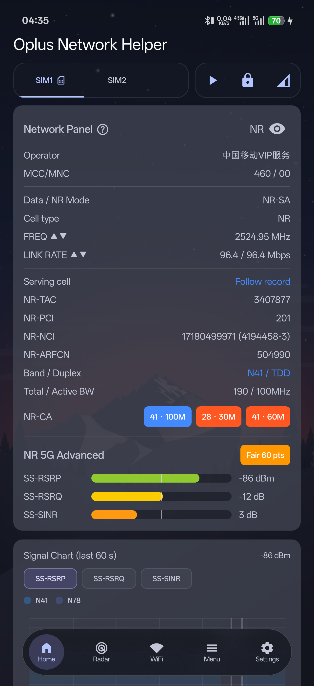
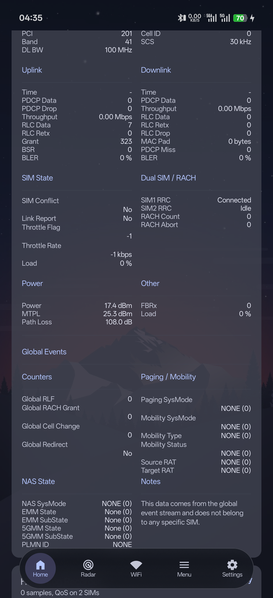
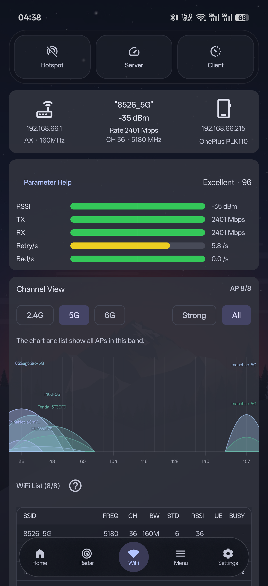
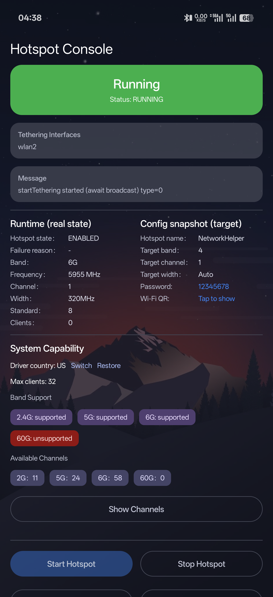

# Oplus Network Helper

[简体中文](README.md)

Oplus Network Helper brings dual-SIM signal monitoring, drive-test recording, band and cell controls, and Wi-Fi tools into one Android app. Use it to inspect your current connection, compare two SIMs, or save measurements along a route and review them on a map.

The current source version is **1.6.7** (versionCode **67**), for **ARM64 devices running Android 10 or later**. The application ID is `com.nvmex.networkhelper`. Advanced features use chipset and vendor interfaces, so availability depends on the phone, firmware, modem and permissions.

## Network and signal monitoring

The Home panel shows each SIM's operator, network type, bands, channels, serving cell and link information. RSRP, RSRQ and SINR readings help describe signal quality. Switch between SIMs or use signal history and the cell timeline to see how the connection changes over time.

Qualcomm devices can also display measurements from individual RX chains. LTE CA comes from QMI. NRCA prefers engineering-mode data and falls back to carrier frequencies reported by QMI; values the device does not report remain unavailable. Transient binding failures trigger at most two reconnection attempts, with the cause and recovery result recorded in the diagnostic console.

The QoS page shows DATA/IMS, QCI, AMBR and NAS information where the device supplies it. MediaTek AT-based reading remains experimental and needs testing on supported hardware. See the [QMI guide](docs/qmi-controls.md) for sources and limitations; the detailed guides are currently in Chinese.

## Band and cell controls

Band and cell controls let you read supported bands, choose network types, set band selections and lock cells. The Drivers & settings tab offers the original Qualcomm QMI driver alongside bunnylock's automatic selection, Qualcomm, MediaTek, Pixel, Unisoc and Android HAL backends. The UI follows the selected backend's capabilities, which vary between devices.

A cell record on Home can carry its SIM, channel and PCI into the control page for review before you execute a lock. Results use modem readback and fresh serving-cell information; insufficient evidence remains unconfirmed. If the app has recorded locks on the default data SIM and detects a sustained mobile-network outage, it offers to clear the locks and wait for reconnection.

Direct Qualcomm QMI access requires root. Some Android HAL and RIL passthrough features work through a running, authorized Shizuku service. Shizuku with ADB privileges does not provide direct QMI or PCI locking on every phone. See [backend integration](docs/modem-backends.md) and [system channel recovery](docs/qmi-system-recovery.md) for driver switching, cleanup and recovery behavior.

This version integrates bunnylock **2.1.0**. The Android NAS code from QCOM BAND MENU has been checked against the upstream revision recorded for this release; the latest OpenWrt changes are outside the phone integration. Source revisions and local adaptations are documented in the [bunnylock notes](bunny-modem/UPSTREAM.md) and [QMI notes](app/src/main/cpp/qmi/UPSTREAM.md).

## Drive testing, maps and local records

The drive-test map records both SIMs at each sample and lets you review tracks by SIM and band. Recordings retain serving-station and sector snapshots, with options to resume, search, preview, and import or export CSV. Nearby-station queries use the backend cell database and support a 1–10 km radius, 4G/5G and band filters. Automatic discovery is off by default.

AMap positioning is the main location source. During outages, a ready inertial estimator can supply marked estimates. Optional Falcon road matching is off by default; when enabled, it uploads tracks to AMap and retrieves driving-road matches while drive-test recording runs. Browsing the map alone does not start track gathering. Railway and subway matching are not provided, and inertial behavior still needs vehicle testing. See the [drive-map guide](docs/drive-test-map.md) and [road-matching notes](docs/map-matching-mvp.md).

Local cell data, Home measurement logs and drive-test recordings have separate management pages. Save and edit your own cell records or exchange measurements with spreadsheet software using CSV. Refreshing cloud caches does not overwrite user-managed local cell records. Coordinate fields, legacy compatibility and import rules are described in [local data management](docs/local-data-management.md). The backend is maintained separately in [NetworkHelperBack](https://github.com/mazemingw/NetworkHelperBack).

## Wi-Fi, hotspots and network tools

The app includes Wi-Fi information and channel occupancy charts, Ping, iPerf testing and VPN hotspot management. Background weak-signal disconnection can leave the current access point when its signal stays below a threshold. The default is −80 dBm, sampled every seven seconds, with two qualifying readings required. Wi-Fi itself stays enabled.

The integrated VPN Hotspot version is **2.19.2**. This update includes tethering interface-state callbacks and forwarding for system IPsec VPN upstreams, while keeping the host app's hotspot settings and entry points. Upstream 3.x replaces routing, the root service and client storage and has not been migrated into this project. See the [VPN Hotspot integration notes](vpnhotspot-mobile/UPSTREAM.md). Forwarding and some configuration features require root and depend on the system and VPN implementation.

## Qualcomm EFS and backups

Qualcomm devices can use the integrated EFS browser and modem-feature tools. After authorization, the app discovers relevant EFS/NV partitions, saves local backups and verifies them. On the first backup, you can choose whether to upload a private cloud copy. Modification becomes available after local verification, and the backup manager can list, download or delete cloud copies.

Changing modem data can cause loss of service or device identity, so keep a usable backup first. The force-skip option offered after a backup failure requires a risk acknowledgement and a timed confirmation. It only bypasses the backup gate for the current session; it does not create a backup or automatically enable writes. See [diagnostics and backup notes](docs/diagnostics.md) for recovery limits.

## Diagnostics and issue reports

Open the diagnostic console from the icon at the top right of Settings to filter, copy, export, share or manually upload logs. This release connects bunnylock, QCOM BAND MENU and VPN Hotspot component logs to that console. Multi-antenna binding failures, SIM mappings, reconnection attempts and final results are recorded there too. After reproducing a problem, export the logs or upload them and provide the receipt.

Automatic error reporting is enabled by default and can be turned off in the console; manual upload remains available. Exported and shared files are redacted. Cloud diagnostic uploads include device and app information, plus IMEI1 in a separate field when it can be read; that identifier is excluded from exported sharing files. See [diagnostics](docs/diagnostics.md) for collection scope, storage limits and upload rules.

## Interface preview

These images show the Home, Wi-Fi and hotspot tools. More are available in the [screenshot directory](docs/images). Some images come from older versions and may differ from the current UI.

<p>
  <a href="docs/images/home/home.png"></a>
  <a href="docs/images/home/qos-data.png"></a>
  <a href="docs/images/WIFI/Screenshot_2026-09-12-04-38-19-73_0b59cd5314832a..png"></a>
  <a href="docs/images/hotspot/Screenshot_2026-09-12-04-38-57-83_0b59cd5314832a..png"></a>
</p>

## Building from source

Use JDK 17, Android SDK 36 (the hotspot module also uses 36.1), NDK `26.3.11579264` and CMake `3.22.1`. Open the project root in Android Studio and allow Gradle to sync. Gradle 8.13 does not support running this project with JDK 25.

Set the local SDK path and your AMap key in the project-root `local.properties`:

```properties
sdk.dir=/path/to/Android/Sdk
AMAP_API_KEY=your_amap_key
```

The map key is packaged into the APK. Restrict it by package name and signing certificate in the AMap console, and keep local configuration and signing material outside version control. Use `./gradlew` on Linux/macOS, or the following in Windows PowerShell:

```powershell
.\gradlew.bat :app:assembleDebug
.\gradlew.bat :app:testDebugUnitTest :bunny-modem:testDebugUnitTest :vpnhotspot-mobile:testDebugUnitTest :qcom-efs:testDebugUnitTest
```

The main app is in `app/`. The integrated libraries are in `bunny-modem/`, `vpnhotspot-mobile/` and `qcom-efs/`. Feature guides and verification records are in `docs/`; native-helper build scripts and mocked tests are in `tools/`. See the [1.6.7 release notes](docs/releases/v1.6.7.md) for this release's checks. Builds and mocked tests do not replace device testing of network behavior, locking, backup restoration or upgrades.

## Open-source projects and licenses

Thanks to the authors and contributors of [bunnylock](https://github.com/btsearch/bunnylock), [QCOM BAND MENU](https://github.com/Fronsipswu/qcom-band-menu), [VPN Hotspot](https://github.com/Mygod/VPNHotspot) and [qcom-efs-browser](https://github.com/catxeon/qcom-efs-browser). This project retains their source attribution, copyright and licenses, and presents their capabilities through its own UI.

Original code uses the [Apache License 2.0](LICENSE). The combined app containing GPL-3.0 components is distributed under GPL-3.0 terms, while compatible license notices on individual files remain in place. See [third-party notices](THIRD_PARTY_NOTICES.md) and [bunny-modem/LICENSE](bunny-modem/LICENSE) for details.
