# Oplus Network Helper

[简体中文](README.md)

An Android network and signal analysis tool for Qualcomm and MediaTek devices.
The application ID is `com.nvmex.networkhelper`. The UI is built with Jetpack
Compose and includes a separate VPN/hotspot library module.

## Source version and downloads

- Current source: `v1.5.7-dev` (versionCode `57`).
- [v1.5.7-dev ARM64 APK and release notes](https://github.com/mazemingw/oplus-network-helper/releases/tag/v1.5.7-dev) (prerelease)
- Architecture: `arm64-v8a`
- APK SHA-256: `bd952a7b29a2b16ce4f337474b1bbafc05f720b4d24fa16a730a6bdd2883e8ae`

## Features

- **Dual-SIM network panel**: compare the operator, data/NR mode, bands, frequency, cell and link information for SIM1 and SIM2, with a data-SIM indicator and cell-change timeline.
- **Signal quality**: display RSRP, RSRQ, SINR, RSSI, signal level and score, with historical signal charts.
- **Drive-test map**: save both SIMs at each sampling tick and switch recorded datasets with SIM tabs. Restoring a Session moves the map to its starting point. Nearby station queries support a 1–10 km radius with independent 4G/5G and optional band filters.
- **QoS diagnostics**: inspect Qualcomm DATA/IMS QCI, AMBR and NAS information with per-SIM caches. The experimental MediaTek AT reader has not been verified on a MediaTek device.
- **Engineer-mode tools**: access network engineering functions and clear engineer-mode files.
- **Bands and cells**: inspect LTE/NR bands, cell parameters and carrier aggregation.
- **Local data management**: manage imported cells and locally recorded cell information. Dedicated home-log and drive-record pages support Excel-compatible CSV import/export, including original and GCJ02 coordinates for new drive points. See the [data-management guide (Chinese)](docs/local-data-management.md).
- **Network utilities**: iPerf speed tests, Wi-Fi information, Ping and VPN/hotspot management; Wi-Fi channel plots compress idle ranges and display separate 80+80 MHz segments.
- **Updates and plugin sharing**: show download, validation and installer phases, validate APK package/version/signatures, and import standalone plugins or sharing archives that contain framework files.
- **Xposed/vendor APIs**: some advanced features require root, Xposed/LSPosed or vendor-specific system APIs.

## Drive testing and nearby stations

Open **Map drawing and discovery** from the drive-map FAB (previously sector drawing settings). Configure sector geometry, sampling interval, nearby discovery, a 1–10 km radius, RAT and optional band. Automatic discovery is off by default, with a 3 km default radius; you can also request an immediate query. Results come from the backend cell-parameter database.

Select all RATs, 4G or 5G independently of the band. Leave the band empty for all bands. A number such as `3` matches that band number within the selected RATs; `B3` restricts LTE and `n78` restricts NR. Conflicting RAT/prefix selections are rejected. Filtering uses channel-number ranges, so overlapping NR bands can match the same frequency.

Opening the map keeps the current location. Only manually restoring a Session moves the camera to its first point. SIM tabs select each recorded dataset, including older single-SIM recordings. See the [drive-map guide (Chinese)](docs/drive-test-map.md).

Map updates add dense markers with continuous full-resolution tracks, handover/serving-sector switches, a red serving-station distance link, scrolling operator names and dedicated map/2D/3D buttons. Recordings show their start city and estimated length, save on exit and can be explicitly selected for continued recording. GPS, accelerometer and gyroscope fusion starts when the map opens and calibrates while driving. It estimates turns and speed changes during GPS outages up to 60 seconds; vehicle validation is still required.

AMap positioning and sampling take priority without waiting for IMU readiness. The speed panel shows only speed and IMU Ready/Not ready. Nearby stations show markers; antenna sectors belong only to the current serving station, including the selected point during replay. Connected station and antenna-sector snapshots are saved with each Session for offline per-SIM replay; marker details append frequencies in MHz. The dual-SIM comparison page scrolls vertically and includes the cell type. NR channel 520830 is labeled as a metro private network, while existing high-speed railway labels are retained.

The Apache 2.0 backend has its own repository: [NetworkHelperBack](https://github.com/mazemingw/NetworkHelperBack). Deploy the updated backend and restart it to enable the [nearby station API](https://github.com/mazemingw/NetworkHelperBack/blob/main/nearby-api.md).

Optional Falcon correction is off by default. The official AMap Android Falcon SDK uploads and queries driving tracks with road matching; no route import is required. Gathering starts and stops with road-test recording; browsing the map does not upload a track. Raw fixes, inertial estimates and dual-SIM measurements remain separate. Railway and subway correction is not supported. The map has translucent overlays, upper-right map/view/speed controls, lower-right actions aligned with the RSRP legend, and bottom-center zoom controls. The serving station is green; selected markers are highlighted, and tapping an information bubble copies its details. Point details and CSV include RSRQ, SINR and NR SS measurements. See [integration and device acceptance notes (Chinese)](docs/map-matching-mvp.md).

Under the More FAB, Band filter and coverage accepts separate comma-separated LTE/NR bands, such as `3,41` and `41,28`, for live points and recording replay. The overlay lists the selected bands and their distance coverage; grey lines retain the unselected road-test path, and all raw samples remain saved. NRCA bandwidth decoding on newer devices uses system capability checks while retaining legacy decoding. See the [analysis (Chinese)](docs/nrca-pyb110-analysis.md).

## Screenshots

Screenshots are grouped by feature under [`docs/images`](docs/images). Click an
image to open the full-size version.

### HOME — Home

<p>
  <a href="docs/images/home/home.png">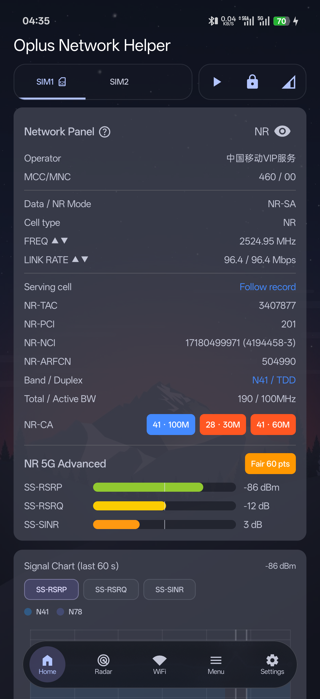</a>
  <a href="docs/images/home/control-panel.png">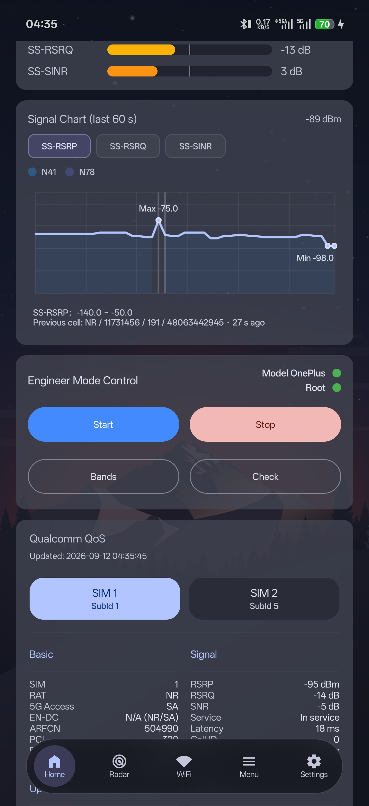</a>
  <a href="docs/images/home/qos-data.png">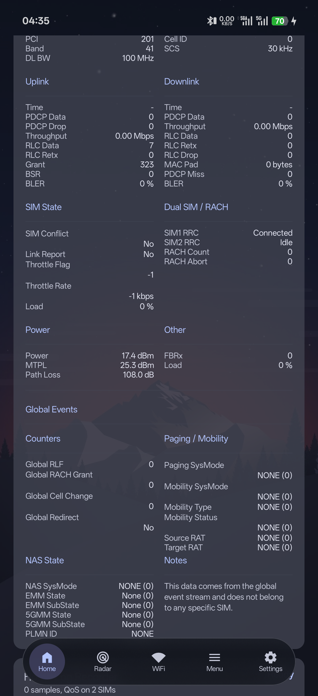</a>
</p>

### LOCKBAND — Band locking

<p>
  <a href="docs/images/LOCKBAND/Screenshot_2026-09-12-04-56-43-38_0b59cd5314832a..png">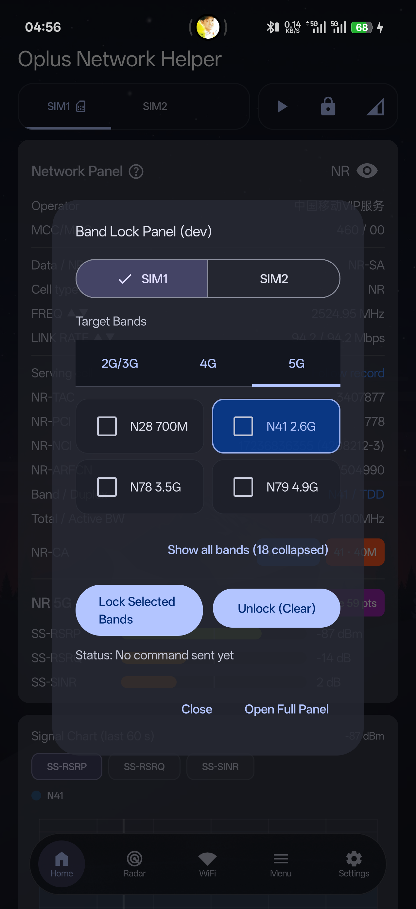</a>
  <a href="docs/images/LOCKBAND/Screenshot_2026-09-12-04-56-54-70_0b59cd5314832a..png">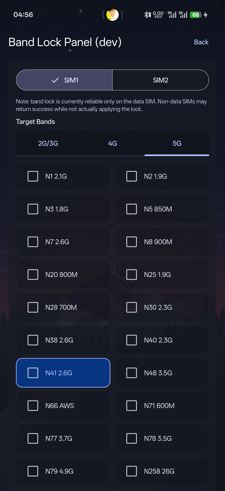</a>
</p>

### RADAR — Signal radar

<p>
  <a href="docs/images/radar/Screenshot_2026-09-12-04-37-58-73_0b59cd5314832a..png">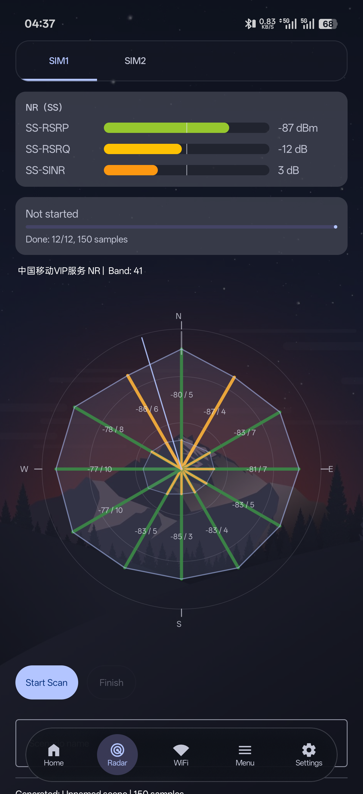</a>
</p>

### WIFI — Wi-Fi

<p>
  <a href="docs/images/WIFI/Screenshot_2026-09-12-04-38-19-73_0b59cd5314832a..png">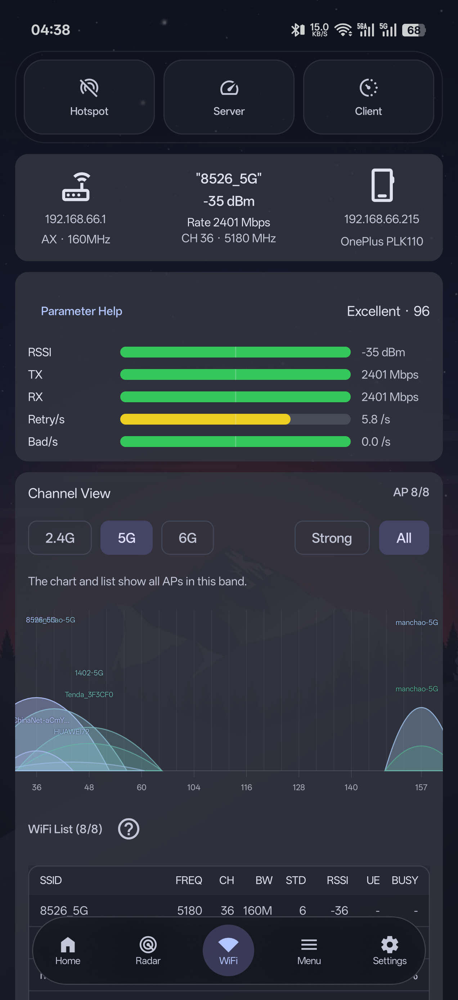</a>
  <a href="docs/images/WIFI/Screenshot_2026-09-12-04-38-32-71_0b59cd5314832a..png">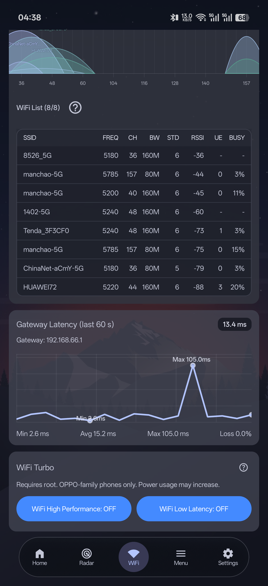</a>
</p>

### HOTSPOT — VPN hotspot

<p>
  <a href="docs/images/hotspot/Screenshot_2026-09-12-04-38-57-83_0b59cd5314832a..png">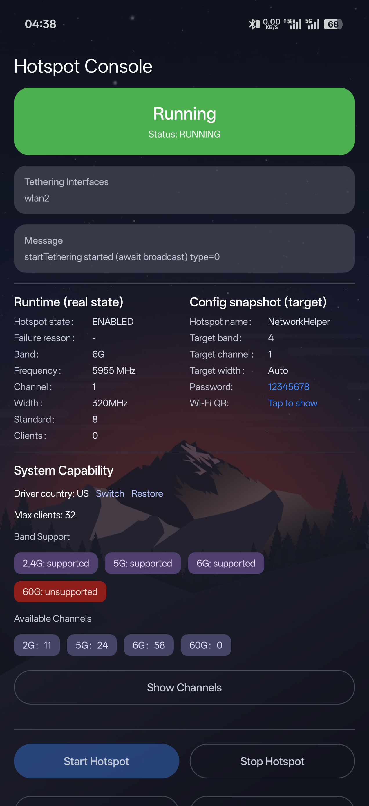</a>
</p>

### MENU — Menu

<p>
  <a href="docs/images/menu/Screenshot_2026-09-12-04-39-08-14_0b59cd5314832a..png">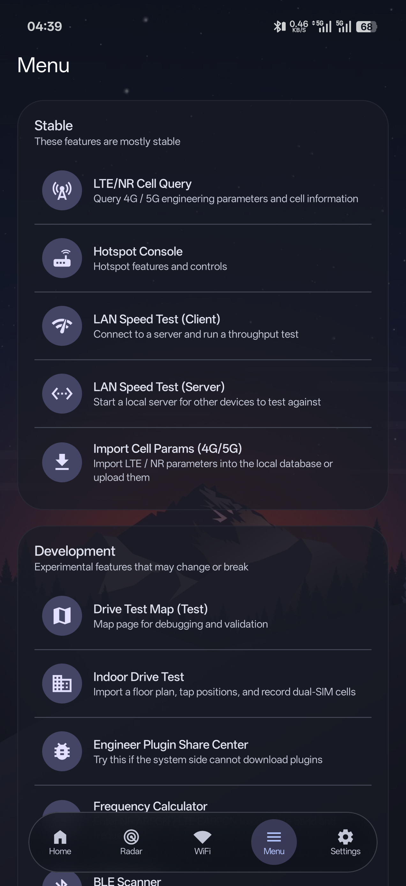</a>
  <a href="docs/images/menu/Screenshot_2026-09-12-04-39-11-61_0b59cd5314832a..png">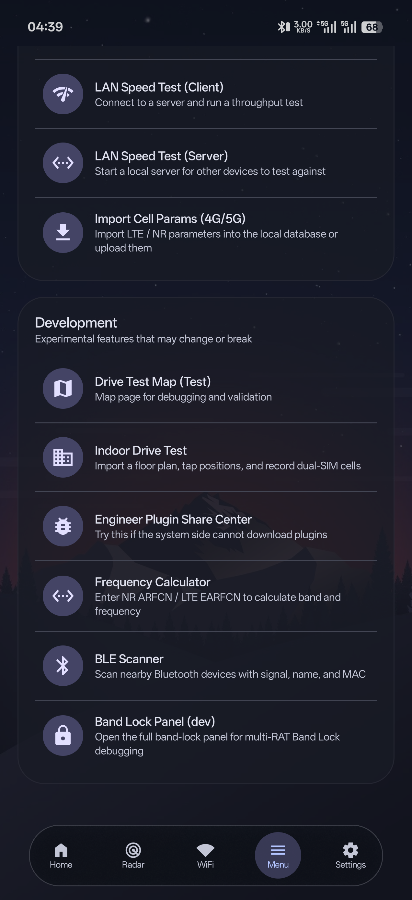</a>
</p>

### SETTINGS — Settings

<p>
  <a href="docs/images/settings/Screenshot_2026-09-12-04-39-27-05_0b59cd5314832a..png">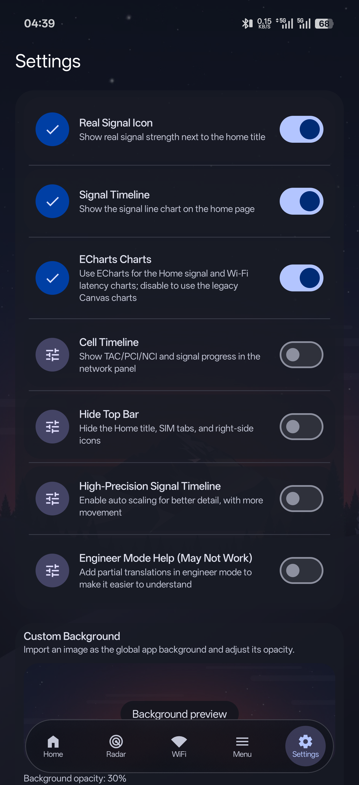</a>
  <a href="docs/images/settings/Screenshot_2026-09-12-04-39-31-15_0b59cd5314832a..png">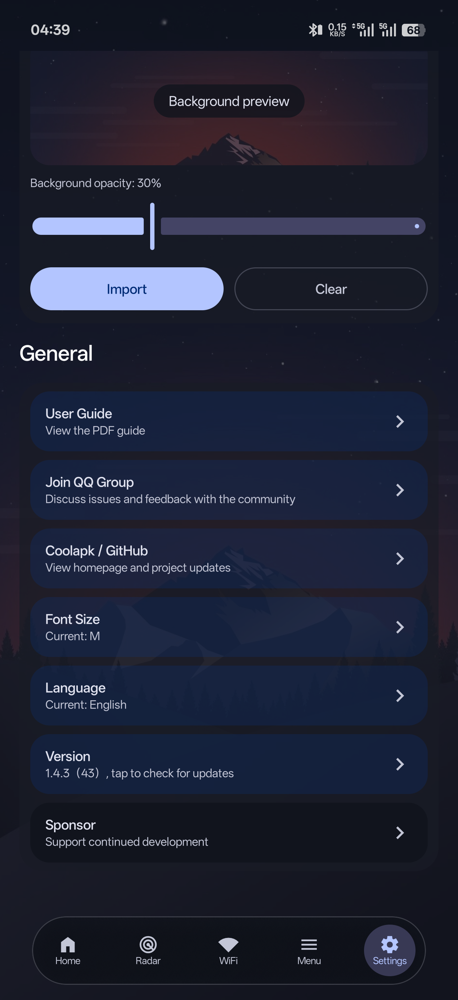</a>
</p>

## Build requirements

- Android Studio (stable recommended)
- JDK 17 (Gradle 8.13 does not support JDK 25)
- Android SDK 36
- Android NDK `26.3.11579264`
- CMake `3.22.1`

Open the project root in Android Studio and wait for Gradle sync:

```bash
./gradlew assembleDebug
```

Windows PowerShell:

```powershell
.\gradlew.bat assembleDebug
```

Run local unit tests and build without connecting a device:

```powershell
.\gradlew.bat :app:testDebugUnitTest :app:assembleDebug
```

See the [existing compatibility verification record](docs/2026-09-18-compatibility-verification.md) and the [drive-map checks and manual test steps](docs/drive-test-map.md).

## Configuration

The local `local.properties` file, signing files, private keys and Firebase
configuration are excluded from version control. Add your AMap key to the
project-root `local.properties`; both debug and release builds will then use it
automatically:

```properties
AMAP_API_KEY=your_amap_key
```

You can temporarily override the local value with `-PAMAP_API_KEY=...` on the
Gradle command line. Note that the key is packaged into the APK; restrict it to
the Android package name/signing SHA-1 in the AMap console and never commit
`local.properties`. Some features require root access, vendor-specific APIs or
a physical target device and may not work on a standard emulator.

## Project structure

```text
app/                  Main application module
vpnhotspot-mobile/    VPN and hotspot library module
gradle/               Gradle wrapper and dependency versions
docs/                 Feature guides, verification records and screenshots
```

## License

Original code in this project is licensed under the **Apache License 2.0**;
see [LICENSE](LICENSE). The repository also contains third-party code under
other licenses. Read [THIRD_PARTY_NOTICES.md](THIRD_PARTY_NOTICES.md) and retain
the applicable copyright and license notices.
