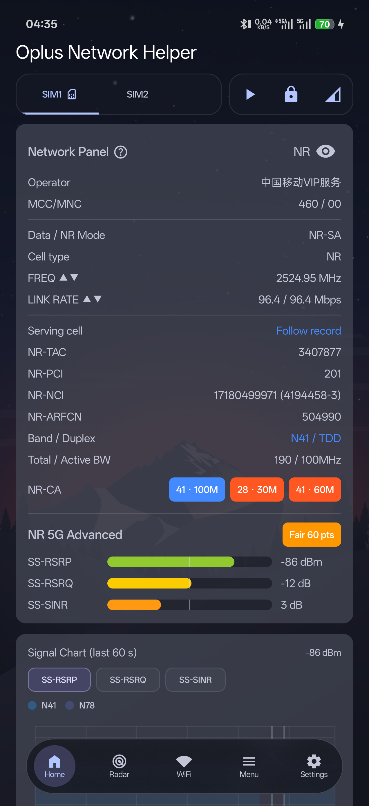
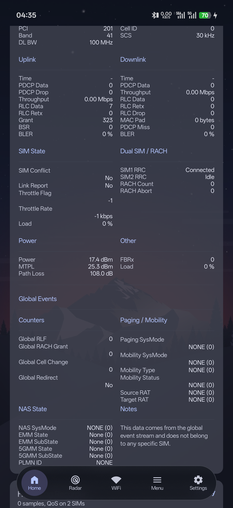
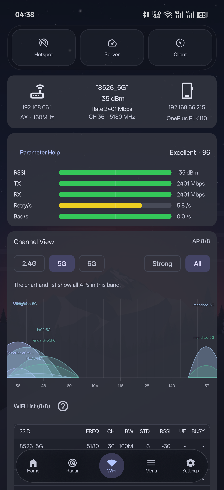
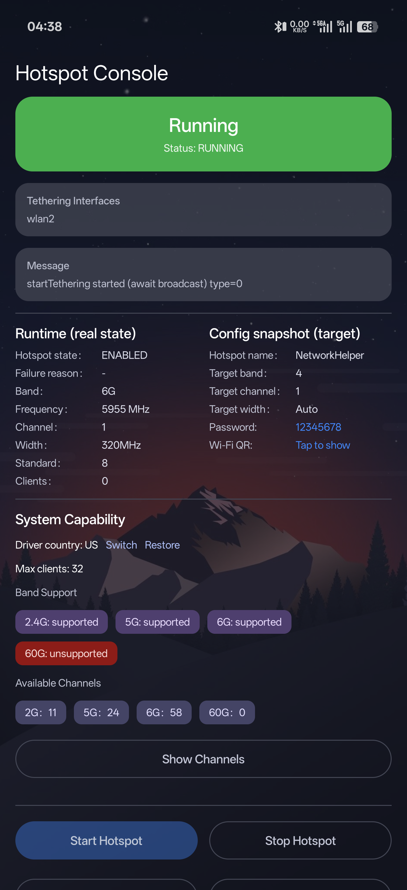

# 欧加网络助手（Oplus Network Helper）

[English](README.en.md)

欧加网络助手把双卡信号观察、路测记录、频段与小区控制，以及 Wi-Fi 和热点工具放在同一个应用里。你可以用它查看手机当前连接的网络，对比两张 SIM 卡的信号，也可以把沿途测量保存下来，再回到地图上查看。

当前源码版本为 **1.6.7**（versionCode **67**），支持 Android 10 及以上的 **ARM64** 设备。应用包名为 `com.nvmex.networkhelper`。高级功能会调用不同芯片和厂商的接口，实际可用范围取决于手机、系统版本、基带和授权情况。

## 观察网络与信号

首页按 SIM 卡展示运营商、网络制式、频段、频点、服务小区和链路信息，并用 RSRP、RSRQ、SINR 等读数帮助判断信号质量。你可以在双卡之间切换，也可以查看历史曲线和基站时域图，了解驻留小区随时间如何变化。

高通设备还可以展开多天线 RX 测量，查看各接收链的读数。LTE CA 来自 QMI，NRCA 优先使用工程模式数据，数据不可用时再尝试 QMI 提供的载波频点；设备没有报告的内容会保留为空。读取遇到临时绑定失败时，应用最多重连两次，并记录失败原因和恢复结果。

QoS 页面提供设备能够报告的 DATA/IMS、QCI、AMBR 和 NAS 信息。联发科 AT 读取仍属实验功能，需要对应设备验证。详细的数据来源和限制见 [QMI 控制说明](docs/qmi-controls.md)。

## 控制频段与小区

在“频段与小区控制”中，可以读取支持的频段、选择网络制式、设置频段或锁定小区。“驱动&设置”提供原有高通 QMI，以及 bunnylock 的自动识别、高通、联发科、Pixel、展锐和 Android HAL 后端。界面按当前后端的能力显示选项，各手机支持的锁定方式并不相同。

首页的小区记录可以把目标 SIM、频点和 PCI 带入控制页，检查后再手动执行。锁定结果会结合基带读回和新的驻留信息判断，证据不足时显示未确认。如果应用记录到默认数据卡仍有锁定，并持续检测到移动网络中断，会提示你尝试解除锁定，再等待网络恢复。

直接访问高通 QMI 需要 Root。部分 Android HAL 或 RIL 透传功能可以通过已启动并授权的 Shizuku 使用，但 Shizuku 的 ADB 权限不会让所有设备都具备直接 QMI 或 PCI 锁定能力。切换驱动、清理通道和系统组件恢复的适用条件见 [多后端说明](docs/modem-backends.md) 与 [系统通道恢复说明](docs/qmi-system-recovery.md)。

本版集成 bunnylock **2.1.0**。QCOM BAND MENU 的 Android NAS 代码已核对至本版记录的上游提交；最新一轮 OpenWrt 改动不属于手机端集成范围。来源版本和本地修改分别记录在 [bunnylock 同步说明](bunny-modem/UPSTREAM.md) 与 [QMI 同步说明](app/src/main/cpp/qmi/UPSTREAM.md)。

## 路测、地图和本地记录

路测地图可以在同一采样时刻保存双卡测量，并在回读时按 SIM 和频段查看轨迹。记录保留服务基站及扇区快照，支持继续录制、搜索、预览和 CSV 导入导出。附近基站查询来自后台工参库，可以选择 1–10 km 半径、4G/5G 制式和频段；自动探测默认关闭。

地图以高德定位为主，定位中断时可使用已就绪的惯导估算，并标记估算点。可选的“猎鹰轨迹纠偏”默认关闭，开启后随路测录制向高德上传轨迹并查询驾车道路匹配结果；仅浏览地图不会启动轨迹采集。它目前不提供铁路或地铁纠偏，惯导效果也仍需实车验证。操作方式见 [路测地图说明](docs/drive-test-map.md) 和 [轨迹纠偏说明](docs/map-matching-mvp.md)。

本地工参、首页采样日志和路测记录有各自的管理入口。你可以保存和编辑本地工参，用 CSV 在应用和表格软件之间交换数据；云端缓存刷新不会覆盖用户管理的本地工参。坐标字段、旧数据兼容和导入规则见 [本地数据管理说明](docs/local-data-management.md)。后台服务单独维护在 [NetworkHelperBack](https://github.com/mazemingw/NetworkHelperBack)。

## Wi-Fi、热点和网络工具

应用提供 Wi-Fi 信息与信道占用图、Ping、iPerf 测速，以及 VPN 热点管理。Wi-Fi 弱信号切断可以在后台断开信号持续低于阈值的当前接入点；默认阈值为 −80 dBm，每 7 秒采样一次，连续两次达到条件才触发，Wi-Fi 本身保持开启。

VPN 热点集成的是 **VPN Hotspot 2.19.2**。这次更新包含热点接口状态回调及系统 IPsec VPN 上游转发支持，并保留当前应用的热点设置和入口。上游 3.x 更换了路由、Root 服务和客户端存储，尚未迁入本项目。具体同步范围见 [VPN 热点说明](vpnhotspot-mobile/UPSTREAM.md)。热点转发和部分配置需要 Root，效果受系统和 VPN 实现影响。

## 高通 EFS 与备份

高通设备可以使用集成的 EFS 浏览和基带功能工具。授权后，应用会发现相关 EFS/NV 分区并保存、校验本地备份；首次备份时可以选择是否上传私有云。通过本地校验后才可继续启用修改，云备份可以在管理页面查看、下载或删除。

修改基带数据可能造成无信号或身份信息丢失，应先保留能够使用的备份。备份失败后提供的“强制跳过”需要阅读风险提示并等待确认，它只放行当前会话的备份门槛，不会生成备份，也不会自动开启修改。更多恢复边界和日志说明见 [诊断与备份说明](docs/diagnostics.md)。

## 日志与问题反馈

从设置页右上角进入“日志监控台”，可以筛选、复制、导出、分享或手动上传日志。本版把 bunnylock、QCOM BAND MENU 和 VPN 热点的组件日志接入同一监控台；多天线测量的绑定失败、SIM 映射、重连及最终结果也会保留。复现问题后导出日志，或上传并提供回执，有助于定位故障。

“自动错误上报”默认开启，可以在监控台关闭；关闭后仍可主动上传。导出和分享的日志会进行脱敏。云端诊断上传包含设备及应用信息，并在能够读取时附带 IMEI1 作为独立字段；它不会出现在导出的分享文件中。具体采集范围、容量和上报规则见 [诊断说明](docs/diagnostics.md)。

## 界面预览

下图展示首页、Wi-Fi 和热点工具，更多图片见 [截图目录](docs/images)。部分截图来自旧版本，当前界面可能有所调整。

<p>
  <a href="docs/images/home/home.png"></a>
  <a href="docs/images/home/qos-data.png"></a>
  <a href="docs/images/WIFI/Screenshot_2026-09-12-04-38-19-73_0b59cd5314832a..png"></a>
  <a href="docs/images/hotspot/Screenshot_2026-09-12-04-38-57-83_0b59cd5314832a..png"></a>
</p>

## 从源码构建

构建需要 JDK 17、Android SDK 36（热点模块还使用 36.1）、NDK `26.3.11579264` 和 CMake `3.22.1`。可以在 Android Studio 中打开项目根目录并等待 Gradle 同步。Gradle 8.13 不支持用 JDK 25 运行此项目。

在项目根目录的 `local.properties` 中填写本地 SDK 路径和高德地图 Key：

```properties
sdk.dir=/path/to/Android/Sdk
AMAP_API_KEY=your_amap_key
```

地图 Key 会进入 APK，请在高德控制台限制包名及签名证书，并将本地配置和签名材料保存在仓库之外。Linux/macOS 使用 `./gradlew`，Windows PowerShell 使用：

```powershell
.\gradlew.bat :app:assembleDebug
.\gradlew.bat :app:testDebugUnitTest :bunny-modem:testDebugUnitTest :vpnhotspot-mobile:testDebugUnitTest :qcom-efs:testDebugUnitTest
```

主应用位于 `app/`，三个集成库分别位于 `bunny-modem/`、`vpnhotspot-mobile/` 和 `qcom-efs/`。功能文档和验证记录位于 `docs/`，原生助手构建及模拟测试脚本位于 `tools/`。本次发布的验证结果见 [1.6.7 发布说明](docs/releases/v1.6.7.md)；编译和模拟测试不能替代目标设备上的网络、锁定、备份恢复及覆盖安装验证。

## 开源来源与许可证

感谢 [bunnylock](https://github.com/btsearch/bunnylock)、[QCOM BAND MENU](https://github.com/Fronsipswu/qcom-band-menu)、[VPN Hotspot](https://github.com/Mygod/VPNHotspot) 和 [qcom-efs-browser](https://github.com/catxeon/qcom-efs-browser) 的作者与贡献者。本项目保留这些组件的来源、版权和许可证，并使用自己的界面组织相关能力。

原创代码采用 [Apache License 2.0](LICENSE)。包含 GPL-3.0 组件的组合应用按 GPL-3.0 条件分发，原文件已有的兼容许可证声明继续保留。各组件的具体范围见 [第三方声明](THIRD_PARTY_NOTICES.md) 和 [bunny-modem/LICENSE](bunny-modem/LICENSE)。
