# 欧加网络助手（Oplus Network Helper）

[English version](README.en.md)

面向 Android 高通/联发科设备的网络与信号分析工具。应用包名为
`com.nvmex.networkhelper`，使用 Jetpack Compose 构建，并包含独立的 VPN/热点功能模块。

## 版本与安装包

- 当前源码：`v1.5.7-dev`（versionCode `57`）。
- [v1.5.7-dev ARM64 安装包与发布说明](https://github.com/mazemingw/oplus-network-helper/releases/tag/v1.5.7-dev)（预发布）
- 架构：`arm64-v8a`
- APK SHA-256：`bd952a7b29a2b16ce4f337474b1bbafc05f720b4d24fa16a730a6bdd2883e8ae`

## 主要功能

- **双卡网络面板**：对比 SIM1/SIM2 的运营商、数据网/NR 模式、频段、频点、小区和链路信息，标记数据卡并展示小区变化时间线。
- **信号质量**：显示 RSRP、RSRQ、SINR、RSSI、信号等级和评分，并支持历史信号曲线。
- **路测地图**：同一采样时刻保存双卡数据，回读时用 TAB 切换数据组；仅主动恢复 Session 时定位到记录起点。支持 1–10 km 附近基站查询，并独立筛选 4G/5G 制式及 Band。
- **QoS 诊断**：查看高通 DATA/IMS 的 QCI、AMBR、NAS 等数据及按 SIM 保存的缓存；联发科 AT 读取通道为实验功能，尚未真机验证。
- **工程模式工具**：访问网络工程模式能力，并提供工程模式文件清理工具。
- **频段与小区**：查看和分析 LTE/NR 频段、小区参数、载波聚合等信息。
- **本地数据管理**：管理导入工参与本地随行随录数据；首页日志、路测记录提供独立管理页及兼容 Excel 的 CSV 导入导出，路测点同时保存原始坐标与 GCJ02 坐标。详见 [数据管理说明](docs/local-data-management.md)。
- **网络工具**：集成 iPerf 测速、Wi-Fi 信息、Ping 和 VPN/热点管理；Wi-Fi 信道图支持空闲区间压缩和 80+80 MHz 占用展示。
- **应用更新与插件共享**：更新下载显示下载、校验和安装阶段，检查 APK 包名、版本及签名；插件导入兼容独立插件包与包含 framework 的分享包。
- **Xposed/厂商接口**：部分高级功能需要 root、Xposed/LSPosed 或特定厂商系统接口。

## 路测与附近基站

在路测地图 FAB 中打开 **地图绘制与探测参数**（原“扇区绘制参数”），可设置扇区角度/距离、采样间隔、附近基站探测开关、1–10 km 半径、制式和可选 Band。探测默认关闭，默认半径 3 km；也可点击“立即探测”。查询的是后台工参库中的基站。

制式可选全部、4G 或 5G，Band 留空表示不限频段。数字（如 `3`）筛选所选制式的同号频段；`B3` 限定 4G，`n78` 限定 5G。制式与前缀冲突时会提示修改。频段按工参频点范围匹配，NR 重叠频段可能同时命中。

进入地图时保留当前位置，在“路测记录”管理页选择“回读”后才切换到记录起点。双卡记录分别显示在 SIM TAB 中，旧单卡记录仍可读取。详见 [路测地图说明](docs/drive-test-map.md)。

地图支持密集打点与完整连续轨迹、切换点/服务站天线面开关、服务站红线与距离、运营商滚动名称，以及独立的地图模式与 2D/3D 小按钮。Session 按起点城市命名并估算长度，支持退出自动保存和选中后继续录制。右侧显示 GPS 速度；打开地图后自动融合 GPS、加速度计与陀螺仪，在行驶中校准，失锁后可估算弯道与加减速，最长 60 秒，仍需实车验证。

高德定位及打点优先运行，惯导只在定位中断时辅助，不等待惯导就绪。速度面板仅显示速度和惯导“就绪／未就绪”。附近基站仅显示标记，扇区只显示当前服务基站的；回读时只展开当前打点对应的服务站。录制时连接过的基站及其扇区保存到 Session，支持按 SIM 离线回读；基站和打点信息窗追加 MHz 频率。双卡信号对比支持上下滑动并显示小区类型，NR 520830 标为“地铁专网”，原有高铁专网规则保留。

后台单独维护于 [NetworkHelperBack](https://github.com/mazemingw/NetworkHelperBack)，采用 Apache 2.0；新增接口需要更新后台并重启服务。协议见 [附近基站接口文档](https://github.com/mazemingw/NetworkHelperBack/blob/main/nearby-api.md)。

可选的“猎鹰轨迹纠偏”默认关闭，使用高德 Android 猎鹰 SDK 上报并查询驾车道路绑路结果，无须导入线路；采集随路测打点开始、停止，仅浏览地图不上传轨迹。原始定位、惯性估算及双卡路测记录独立保留；当前不提供铁路或地铁纠偏。地图采用半透明浮层，右上显示地图/视角/速度，右下 FAB 与 RSRP 图例对齐，底部中央提供缩放。服务基站显示绿色，选中标记高亮，信息气泡支持点按复制；打点弹窗及 CSV 支持 RSRQ、SINR 与 NR SS 指标。详见 [接入与真机验收说明](docs/map-matching-mvp.md)。

在“更多”FAB 的“频段筛选与覆盖率”中分别输入 4G/5G 频段，例如 `3,41` 和 `41,28`，统一筛选实时打点与历史回读。浮层显示具体筛选频段及其有效路测距离覆盖率；未匹配的路测路径用灰线保留，完整原始数据继续保存。新机 NRCA 带宽解析按系统能力兼容，保留旧系统规则，详见 [分析记录](docs/nrca-pyb110-analysis.md)。

## 截图

截图按功能模块存放在 [`docs/images`](docs/images) 中，点击图片可查看原图。

### HOME：首页

<p>
  <a href="docs/images/home/home.png">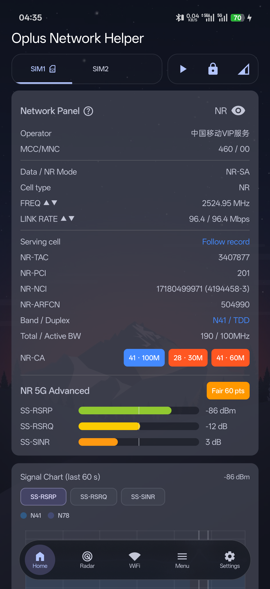</a>
  <a href="docs/images/home/control-panel.png">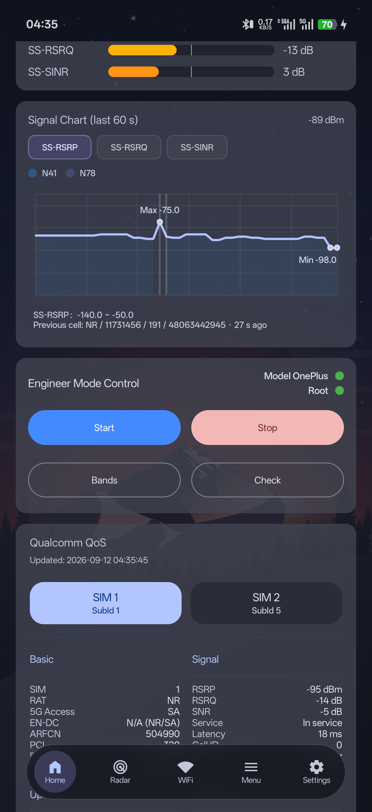</a>
  <a href="docs/images/home/qos-data.png">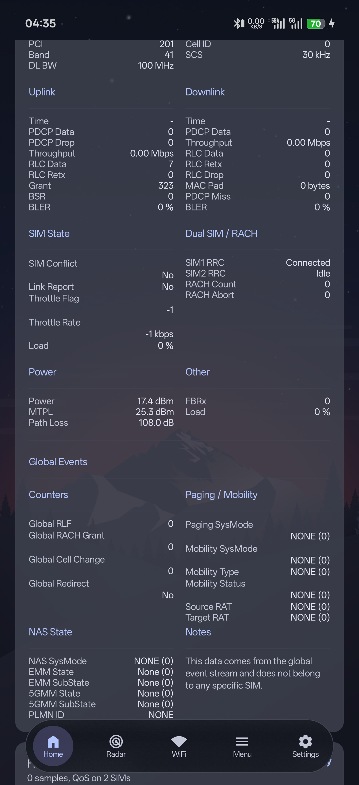</a>
</p>

### LOCKBAND：锁频

<p>
  <a href="docs/images/LOCKBAND/Screenshot_2026-09-12-04-56-43-38_0b59cd5314832a..png">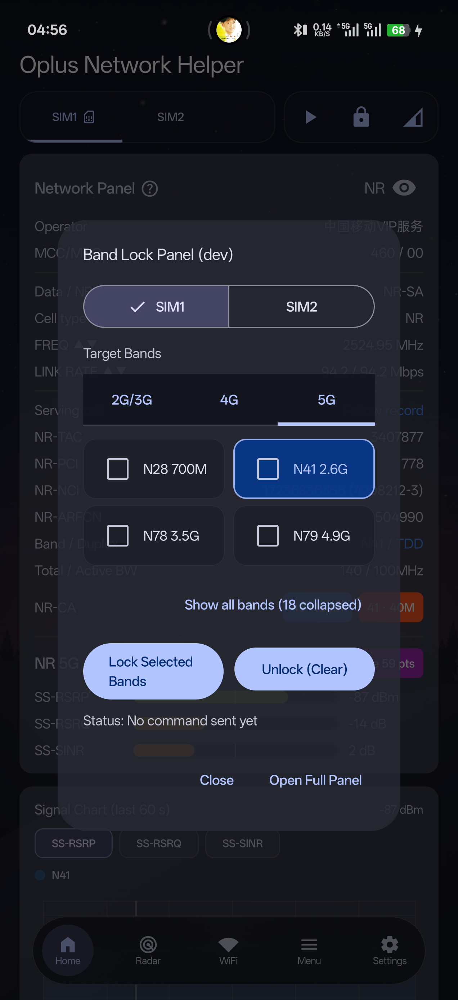</a>
  <a href="docs/images/LOCKBAND/Screenshot_2026-09-12-04-56-54-70_0b59cd5314832a..png">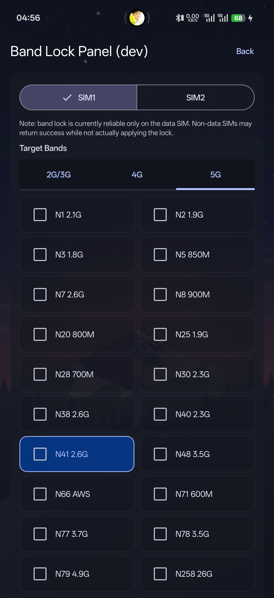</a>
</p>

### RADAR：雷达

<p>
  <a href="docs/images/radar/Screenshot_2026-09-12-04-37-58-73_0b59cd5314832a..png">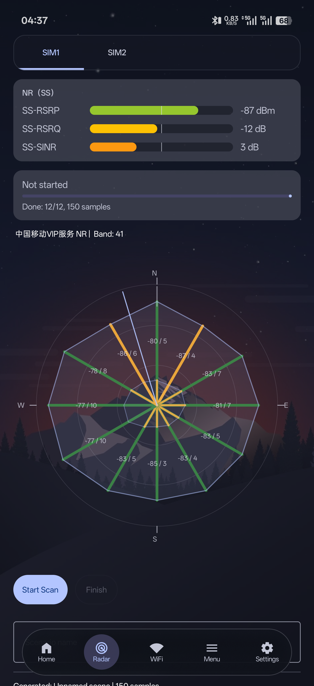</a>
</p>

### WIFI：Wi-Fi

<p>
  <a href="docs/images/WIFI/Screenshot_2026-09-12-04-38-19-73_0b59cd5314832a..png">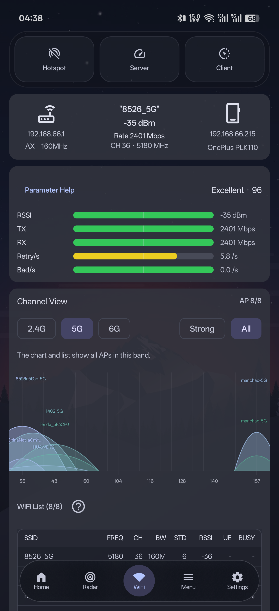</a>
  <a href="docs/images/WIFI/Screenshot_2026-09-12-04-38-32-71_0b59cd5314832a..png">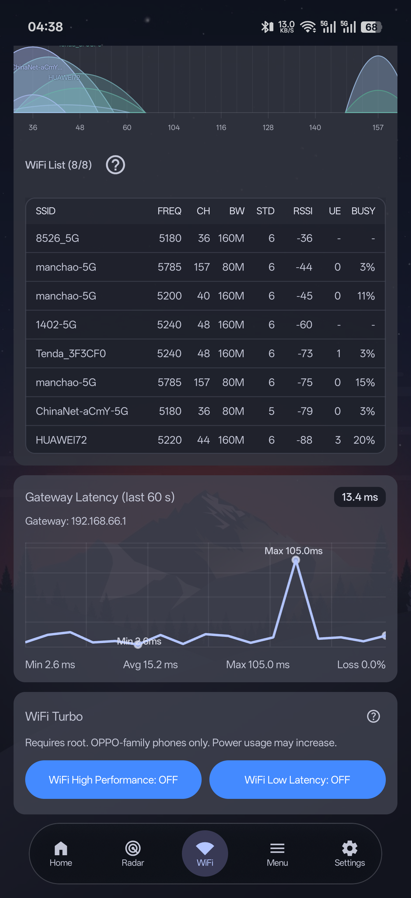</a>
</p>

### HOTSPOT：热点

<p>
  <a href="docs/images/hotspot/Screenshot_2026-09-12-04-38-57-83_0b59cd5314832a..png">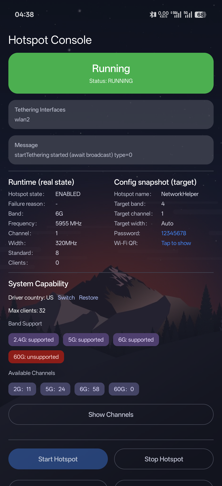</a>
</p>

### MENU：菜单

<p>
  <a href="docs/images/menu/Screenshot_2026-09-12-04-39-08-14_0b59cd5314832a..png">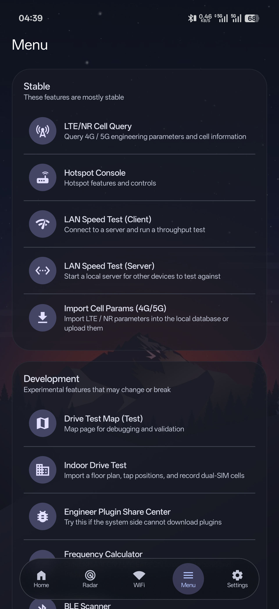</a>
  <a href="docs/images/menu/Screenshot_2026-09-12-04-39-11-61_0b59cd5314832a..png">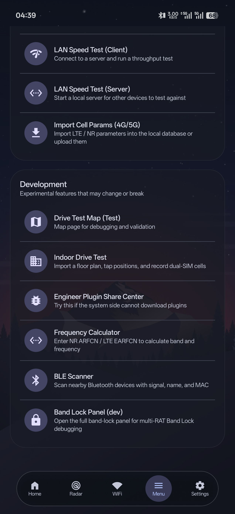</a>
</p>

### SETTINGS：设置

<p>
  <a href="docs/images/settings/Screenshot_2026-09-12-04-39-27-05_0b59cd5314832a..png">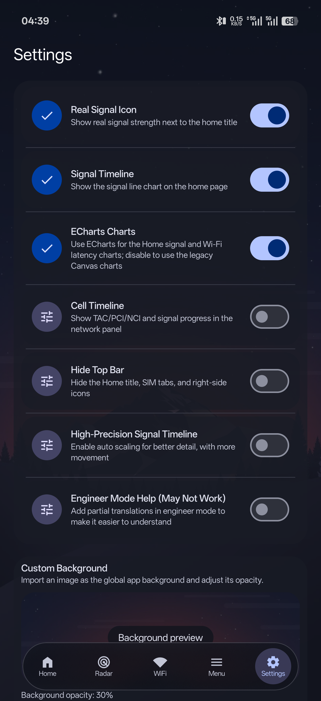</a>
  <a href="docs/images/settings/Screenshot_2026-09-12-04-39-31-15_0b59cd5314832a..png">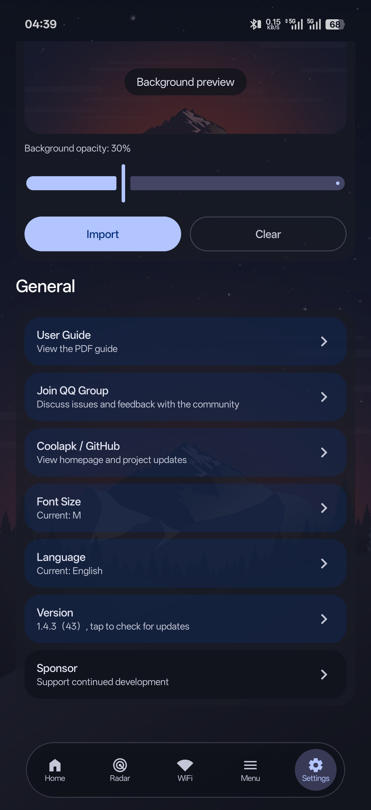</a>
</p>

## 构建环境

- Android Studio（建议使用稳定版）
- JDK 17（Gradle 8.13 不支持 JDK 25）
- Android SDK 36
- Android NDK `26.3.11579264`
- CMake `3.22.1`

在 Android Studio 中打开项目根目录并等待 Gradle 同步：

```bash
./gradlew assembleDebug
```

Windows PowerShell：

```powershell
.\gradlew.bat assembleDebug
```

本地单元测试与 Debug 构建（无需连接设备）：

```powershell
.\gradlew.bat :app:testDebugUnitTest :app:assembleDebug
```

兼容修复的既有验证记录见 [2026-09-18 说明](docs/2026-09-18-compatibility-verification.md)；本次路测检查与手工测试步骤见 [路测地图说明](docs/drive-test-map.md)。

## 配置说明

本地配置文件 `local.properties`、签名文件、私钥和 Firebase 配置不会提交到仓库。
将高德地图 Key 写入项目根目录的 `local.properties`，之后普通编译和 Release 编译都会自动读取：

```properties
AMAP_API_KEY=你的高德Key
```

也可以在 Gradle 命令行使用 `-PAMAP_API_KEY=...` 临时覆盖本地值。注意：Key 会被打包进 APK；请在高德开放平台限制 Key 的 Android 包名/签名 SHA-1，并避免提交 `local.properties`。部分功能需要 root、厂商接口或实体设备，在普通模拟器上可能不可用。

## 项目结构

```text
app/                  主应用模块
vpnhotspot-mobile/    VPN/热点库模块
gradle/               Gradle wrapper 与依赖版本
docs/                 功能说明、验证记录与截图
```

## 许可证

本项目原创代码采用 **Apache License 2.0**，详见 [LICENSE](LICENSE)。仓库还包含采用其他许可证的第三方代码；请阅读 [THIRD_PARTY_NOTICES.md](THIRD_PARTY_NOTICES.md)，并保留相应的版权和许可证声明。
